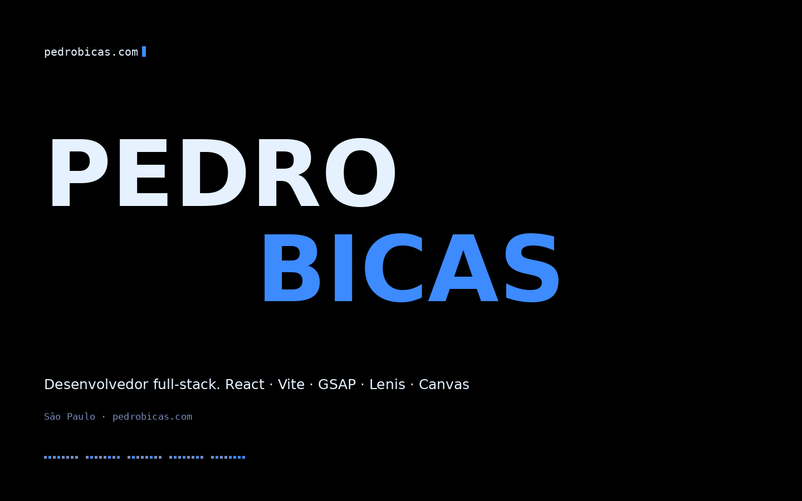

# Pedro Bicas — Portfólio

[](https://github.com/pedrobicas/pedrobicas.com/actions/workflows/ci.yml)

Portfólio pessoal de Pedro Bicas, desenvolvido com React + Vite e uma camada visual baseada em GSAP, Lenis, Canvas e SVG. A implementação prioriza duas coisas ao mesmo tempo: preservar a experiência visual original e manter uma arquitetura de código clara, modular e testável.

[**Abrir pedrobicas.com**](https://pedrobicas.com)



## Stack

- React 18
- Vite 6
- JavaScript ES Modules
- GSAP + ScrollTrigger
- Lenis
- Canvas e SVG
- ESLint + regras de React Hooks e acessibilidade
- Prettier
- Node Test Runner
- Playwright
- GitHub Actions

## O que existe no projeto

A home inclui loader animado, cursor customizado, navegação por seções, animações tipográficas, canvas binário, terminal interativo, trajetória, projetos em scroll horizontal, galeria com filtros e visualização em lista/grade, painel de detalhes, currículo imprimível e contato.

A aplicação também respeita `prefers-reduced-motion`: quando o usuário pede menos movimento, as animações mais intensas são desativadas sem remover conteúdo ou funcionalidade.

## Arquitetura

```text
src/
├── components/   # UI reutilizável, overlays, galeria e detalhes
├── sections/     # Seções principais da home
├── data/         # Projetos, stack, trajetória e constantes
├── hooks/        # Ponte entre o lifecycle do React e o runtime visual
├── runtime/      # GSAP, Lenis, Canvas, observers, cursor e navegação
├── utils/        # Funções puras e helpers
├── App.jsx
├── main.jsx
└── styles.css

tests/
├── unit/         # Utilitários, dados e integridade visual
└── e2e/          # Smoke tests em Chromium com Playwright
```

O React é responsável pela estrutura e pelo conteúdo declarativo. Código imperativo fica restrito ao que realmente exige acesso direto ao DOM: medições de layout, ScrollTrigger, Canvas, Lenis, cursor magnético e algumas transições de navegação.

As ilustrações dos projetos são JSX/SVG reais; não há `dangerouslySetInnerHTML`. O CSS visual aprovado é protegido por um teste de hash para evitar alterações acidentais durante refactors.

Mais detalhes em [`docs/ARCHITECTURE.md`](./docs/ARCHITECTURE.md).

## Rodando localmente

Recomendado: Node `22.19.0` ou uma versão compatível com o campo `engines` do `package.json`.

```bash
npm install
npm run dev
```

Produção:

```bash
npm run build
npm run preview
```

## Qualidade

```bash
npm run lint          # ESLint
npm run format        # formata arquivos suportados
npm run format:check  # valida formatação
npm run lockfile      # regenera somente o package-lock.json
npm run test:unit     # testes rápidos sem browser
npm run test:e2e      # smoke tests com Playwright
npm run check         # lint + unit + build
npm run verify        # check + instala Chromium + e2e
```

O `npm run verify` já garante a instalação do Chromium gerenciado pelo Playwright antes dos smoke tests. Se quiser rodar apenas `npm run test:e2e` isoladamente numa máquina nova, use antes `npm run test:e2e:install`.

O CI do GitHub executa lint, testes unitários, build e smoke tests em Chromium. O projeto também declara explicitamente o script de instalação do `esbuild` como permitido para npm 12, evitando instalações incompletas com o binário do Vite bloqueado. Quando `package-lock.json` está versionado, o workflow usa `npm ci`; em um checkout ainda sem lockfile, faz `npm install`. O Dependabot verifica atualizações de dependências mensalmente.

## Conteúdo

Os dados que mudam com mais frequência ficam separados da camada visual:

- `src/data/projects.js` — projetos e links
- `src/data/stack.js` — tecnologias
- `src/data/journey.js` — trajetória
- `src/data/site.js` — constantes globais

## Decisões de engenharia

O projeto usa React StrictMode em desenvolvimento. O runtime visual devolve cleanup ao React e remove listeners, observers, timers, tickers, instâncias de Lenis e ScrollTriggers ao desmontar.

A interface foi mantida deliberadamente próxima da versão original. Por isso o CSS principal não é reformatado automaticamente pelo Prettier; `src/styles.css` fica na lista de ignore e é protegido por teste de integridade.

## Código e uso

O repositório é público para demonstrar implementação e decisões de engenharia. **Não é um projeto open source e não possui licença de reutilização.**

© 2026 Pedro Bicas. Todos os direitos reservados.
